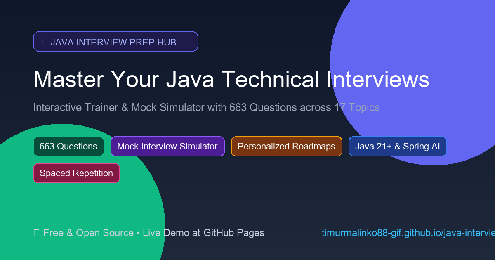

<div align="center">
  
# 🚀 Java Interview Prep Hub & AI Simulator
**The Ultimate Software 3.0 Platform for Acing Java Engineering Interviews**

<p align="center">
  
  
  
  
  
  
  
  
  <a href="https://timurmalinko88-gif.github.io/java-interview/"></a>
</p>

An interactive, hyper-optimized Single Page Web Application (SPA), mock interview simulator, learning roadmap system, and structured knowledge base engineered for acing technical Java interviews — from **Junior** to **Senior** and **Lead / Architect** level.

[](https://timurmalinko88-gif.github.io/java-interview/)
[](#-core-breakthrough-features)
[](https://github.com/timurmalinko88-gif/java-interview)

<br>

<br><br>

</div>

---

## 🌟 Visual Showcase / Demo Highlights

| 🧠 **In-Browser AI Examiner** | 🔍 **Client-Side RAG Search** |
| :--- | :--- |
| Real-time Web Speech dictation with quantized LLMs (`Qwen2.5-Coder` / `Llama-3.2`) running via WebGPU directly in your browser. Complete with ground-truth scorecard evaluation. | Instant $< 0.5$ ms cosine similarity search across 748 questions via `all-MiniLM-L6-v2` and Web Workers. No backend required. |

| 🏗️ **Interactive Architecture Flow** | 🧮 **Algorithm Breakdown Engine** |
| :--- | :--- |
| Interactive System Architecture SVG Flow Simulator mapping data flow across microservices layers with production code snippets. | Step-by-step interactive visual breakdowns for classic sorting, dynamic programming, and graph algorithms. |

---

## 🚀 Core Breakthrough Features

- 🧠 **Zero-Server Semantic Vector Search (Client-Side RAG)**: On-the-fly cosine similarity via `all-MiniLM-L6-v2` & Web Workers ($< 0.5$ ms search across **748 questions** with RU/EN synonym expansion).
- 🎙️ **In-Browser WebLLM AI Examiner & Feynman Coach**: Instant $0\text{ ms}$ heuristic evaluator + WebGPU hardware acceleration running quantized LLMs (`Qwen2.5-Coder` / `Llama-3.2`) directly in the browser with real-time Web Speech dictation, ground-truth scorecards, and Richard Feynman life analogies.
- 🤖 **LLM Integration Track & Spring Boot 3 Support Assistant**: Dedicated 8-module curriculum (Prompting, Structured Outputs, Tool Calling, RAG, Guardrails, Google Antigravity & MCP), interactive tool-calling simulator, and reference backend (`projects/java-llm-support-assistant`) with server-side RBAC, WireMock tests, and 15 eval benchmarks.
- 🗺️ **6 Curated Learning Tracks (Roadmaps) & Adaptive Diagnostic Engine**:
  1. 🚀 **Transition to Java (6–8 Weeks)**: 162 ordered questions across 4 stages with an 80% Mastery gate.
  2. 🌱 **Junior Express**: Core Java, OOP, Collections, and SQL fundamentals.
  3. ⚙️ **Middle Spring & Microservices**: Spring Boot, JPA/Hibernate, Concurrency, and Kafka.
  4. 🏛️ **Senior Architect Track**: Highload System Design, JVM internals, GC tuning, and distributed patterns.
  5. ✨ **AI & Modern Java 21+ Track**: Virtual Threads (Project Loom), Structured Concurrency, Spring AI, and RAG.
  6. 🤖 **LLM Integration & Antigravity Track**: 8 hands-on modules + production Spring Boot 3 project.
- 🏗️ **Interactive System Architecture SVG Flow Simulator**: Step-by-step animated request flows across microservices layers with live terminal logs and production trade-offs.
- 🧮 **Algorithm Breakdown Engine**: 50 LeetCode-style algorithmic breakdowns filtered by pattern (`Two Pointers`, `Sliding Window`, `DP`, `Graphs`, `Trees`) with time/space complexity badges.
- ⚡ **Spaced Repetition (Leitner Box SRS) & Rank Gamification**: Ebbinghaus forgetting-curve scheduling (`Hard` / `Good` / `Easy`), XP progression, and JSON Backup / Custom Questions import.

---

## 🛠 Complete Tech Stack & Engineering Highlights

| Category | Technologies | Description |
| :--- | :--- | :--- |
| **Frontend & UI** | Vanilla JS (ES Modules), Vite 8, Tailwind CSS, Marked.js, Highlight.js, FontAwesome 6 | Ultra-fast, zero-framework reactive SPA with Attio/Linear glassmorphic design, Dark/Light themes, and $O(1)$ `Set`-based DOM updates. |
| **AI & Machine Learning** | WebGPU TVM/MLC (`@mlc-ai/web-llm`), ONNX Runtime Web / Transformers.js (`@xenova/transformers`, `all-MiniLM-L6-v2`), Web Speech API | 100% client-side intelligence executing quantized LLMs & embedding models in background Web Workers with `$0.00` server cost. |
| **Security & Offline PWA** | Content-Security-Policy (CSP), DOMParser HTML Sanitizer, Workbox Service Worker | Hardened against DOM XSS & Prototype Pollution; works 100% offline as an installable Progressive Web App. |
| **Indexing & Tooling** | Python 3 AST/Frontmatter builder (`build.py`), Node.js vector generator (`tools/build_embeddings.mjs`) | Automated pipeline indexing 748 Markdown files into `public/index.json` and pre-computing vector embeddings. |
| **Quality Assurance** | Playwright E2E Suite (66 tests) | Comprehensive automated tests covering search, RAG, Leitner SRS, hotkeys, responsive viewports, and modals. |

---

## 📊 Content Breakdown & Statistics (748 Questions)

The knowledge base contains **748 curated questions** across **18 specialized engineering domains**:

| Domain / Category | Questions | Key Topics Covered |
| :--- | :---: | :--- |
| **Spring** | **61** | IoC/DI, Bean Lifecycle, AOP, `@Transactional` pitfalls, Spring Boot 3, Security, Spring Data |
| **System Design** | **59** | Microservices, Outbox/Saga, Sharding, Replication, Caching, Rate Limiting, CAP/PACELC |
| **Databases** | **54** | PostgreSQL, B-Tree/LSM Indexes, ACID, Isolation Levels, MVCC, JPA/Hibernate N+1, Locks |
| **Collections** | **53** | `HashMap` internals, `ConcurrentHashMap`, Red-Black Trees, Fail-Fast vs Fail-Safe, Queues |
| **OOP** | **53** | SOLID, GRASP, Immutability, `equals()`/`hashCode()` contracts, Inheritance vs Composition |
| **AI & LLM Integration** | **52** | Spring AI, RAG pipelines, Vector DBs (`PgVector`), Tool Calling, Guardrails, MCP & Agents |
| **JVM & Memory Management** | **52** | Heap/Stack, JMM, G1/ZGC/Shenandoah, ClassLoaders, JIT Compilation, Memory Leaks, Profiling |
| **Multithreading** | **52** | `volatile`, `synchronized`, CAS, AQS, `CompletableFuture`, Thread Pools, Deadlocks, Locks |
| **Stream API** | **52** | Functional Interfaces, Spliterators, Parallel Streams, Collectors, Method References |
| **Algorithm Breakdown** | **50** | Two Pointers, Sliding Window, Binary Search, DFS/BFS, Dynamic Programming, Monotonic Stack |
| **Patterns** | **50** | GoF Creational, Structural, Behavioral, and Enterprise Microservice Patterns |
| **Testing** | **50** | JUnit 5, Mockito, Testcontainers, WireMock, TDD, Contract & Integration Testing |
| **General (Core Java)** | **47** | Generics & Type Erasure, Strings, Serialization, Reflection, Records, Sealed Classes |
| **Kafka & Messaging** | **21** | Partitions, Consumer Groups, Rebalancing, Exactly-Once, DLQ, RabbitMQ vs Kafka |
| **Live Coding & Refactoring** | **15** | Concurrency bugs, Resource leaks, Transaction traps, Code Review anti-patterns |
| **Modern Java 21+** | **15** | Virtual Threads (Loom), Scoped Values, Structured Concurrency, Pattern Matching, Sequenced Collections |
| **Behavioral & STAR** | **10** | Conflict resolution, Production post-mortems, Leadership, Architecture trade-off defense |
| **Exceptions** | **2** | Checked vs Unchecked hierarchy, `try-with-resources`, Suppressed Exceptions |
| **Total** | **748** | **100% Structured with Answers, Code Snippets & Life Analogies** |

---

## 🚀 Quick Start & Local Development

Experience the full capabilities of the platform locally in 3 simple steps:

```bash
# 1. Clone the repository
git clone https://github.com/timurmalinko88-gif/java-interview.git
cd java-interview

# 2. Install dependencies
npm install

# 3. Start the Vite 8 dev server
npm run dev
```

### Build & Indexing Chain
If you modify content or embeddings, use the built-in pipelines:
```bash
# Rebuild the question index JSON
python build.py

# Regenerate vector embeddings for semantic search
node tools/build_embeddings.mjs

# Build for production
npm run build
```

### Testing
Run the E2E test suite using Playwright:
```bash
npx playwright test
```

---

## 🤖 Vibecoding & Software 3.0 Extensibility

This repository is built with an AI-first mindset. It fully embraces the **Software 3.0** paradigm. 
If you wish to contribute or generate new question banks, we provide a structured `VIBECODING.md` and `AGENTS.md` guide. 

Developers can seamlessly vibecode new features, interactive visualizers, or UI components using modern LLMs (Claude 3.5 Sonnet, GPT-4o, etc.). Just feed the provided context documents to your agent and watch it construct production-ready code aligned with our vanilla architecture.

---

## 🤝 Community & Contributing

We welcome contributions of all sizes! 

1. **Fork** the repository and create your feature branch (`git checkout -b feature/amazing-feature`).
2. **Commit** your changes (`git commit -m 'Add some amazing feature'`).
3. Ensure you run `python build.py` and `node tools/build_embeddings.mjs` if you add new content.
4. **Push** to the branch (`git push origin feature/amazing-feature`).
5. Open a **Pull Request**.

Please refer to the `AGENTS.md` and `VIBECODING.md` files for deeper architectural insights and contribution guidelines.

---

## 📜 License

Distributed under the **MIT License**. See the `LICENSE` file for more information.

<p align="center">
  <i>Empowering engineers to master Java, from core fundamentals to cutting-edge AI integration.</i>
</p>
